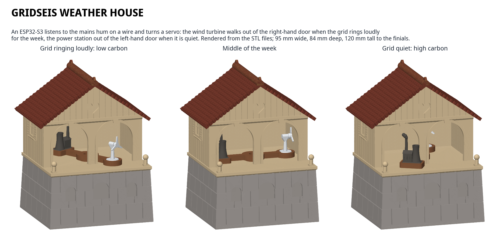
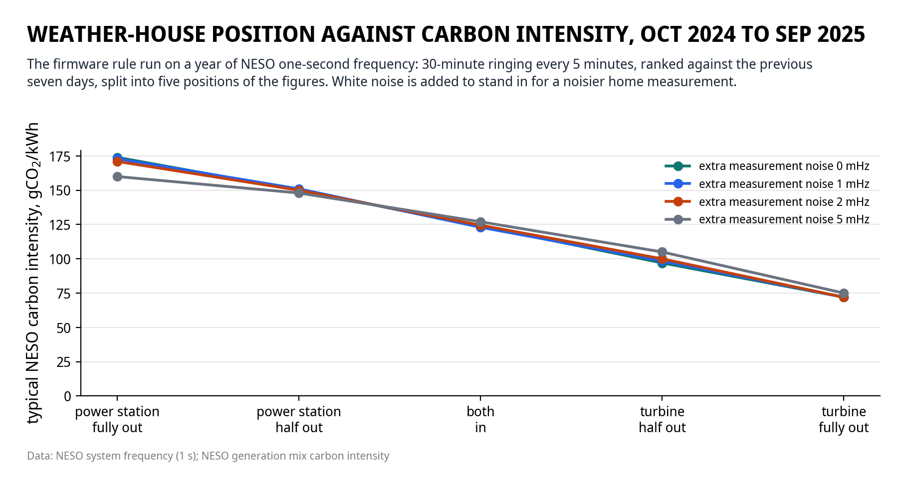
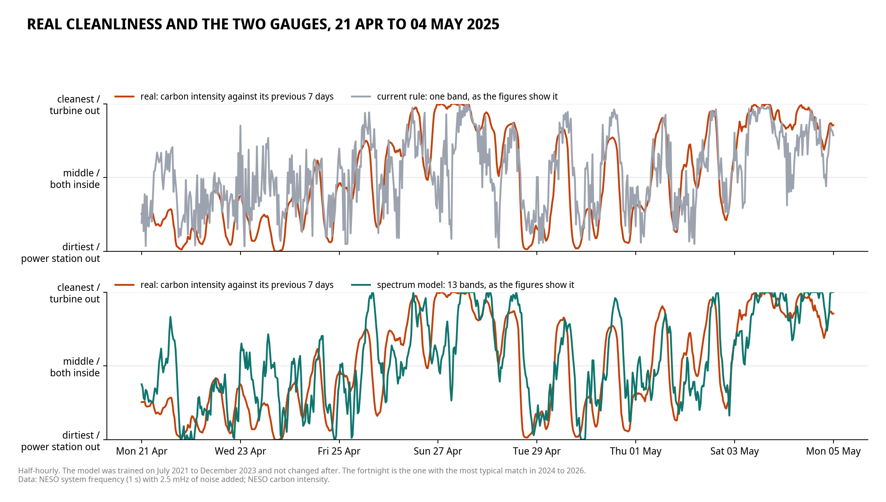
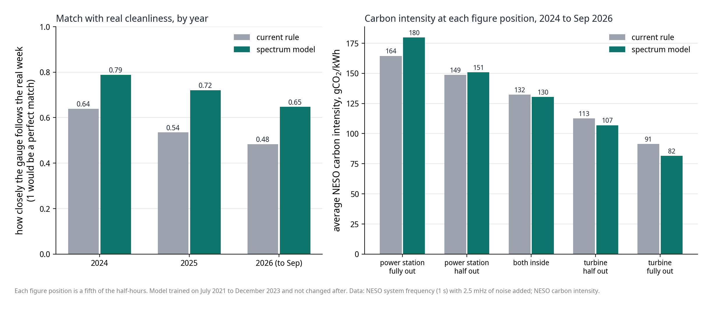
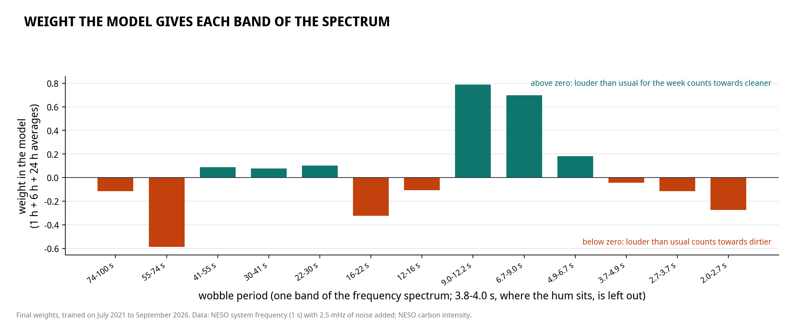
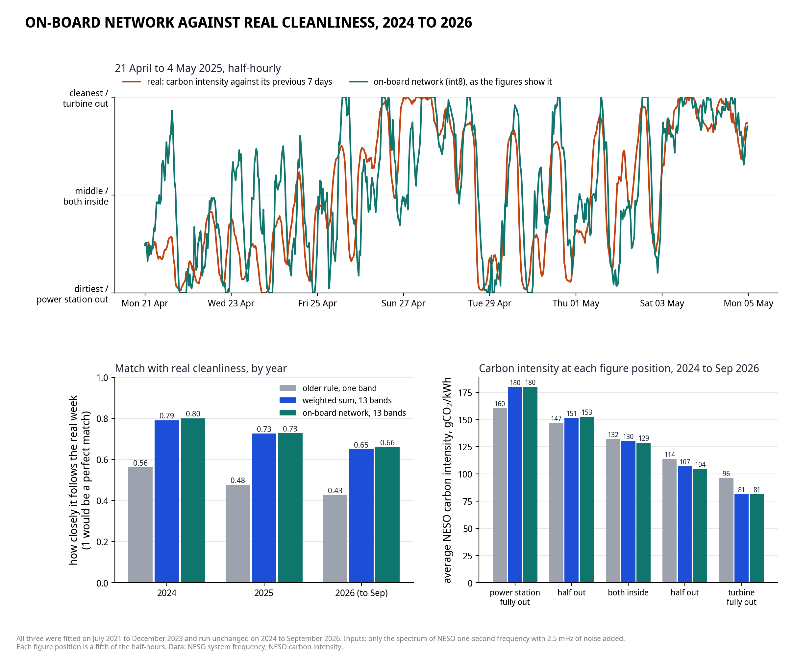
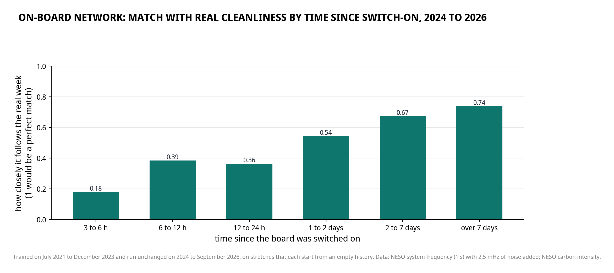
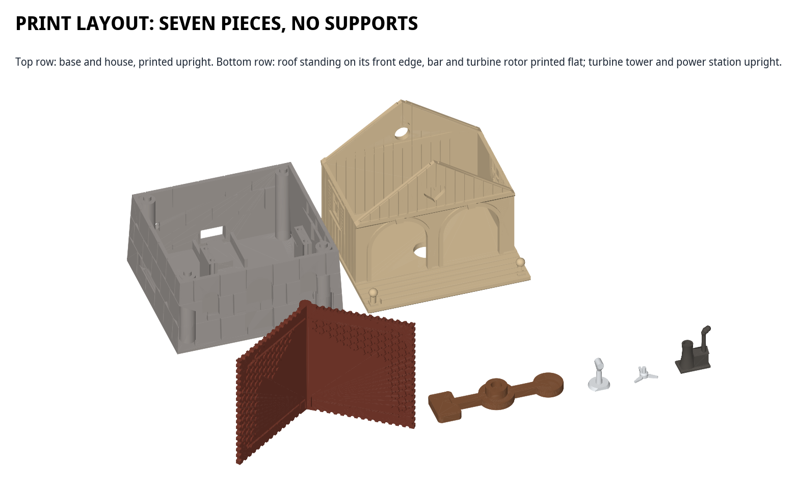

# GridSeis weather house

A plug-in carbon gauge in the style of the Austrian weather houses, the ones where a catgut string
turns a little platform and a figure with an umbrella comes out of the door when rain is coming.
This one listens to the mains hum instead. An ESP32-S3 picks up the 50 Hz field around a nearby mains
cable with a short piece of wire, measures the grid frequency once a second, and every 5 minutes
looks at how the frequency has been wobbling over the last half hour. A servo turns the figure bar:

- **the wind turbine walks out of the right-hand door** when the grid is cleaner than usual for the
  week: a light grid, lots of wind and solar;
- **the power station walks out of the left-hand door** when it is dirtier than usual: a heavy grid,
  lots of gas;
- both stay inside on an average day.

The figures follow a small neural network that runs on the ESP32-S3 itself, with TensorFlow Lite Micro.
It reads 13 bands of the wobble, from 2 to 100 second periods, hour by hour over the last day (see
[The spectrum model](#the-spectrum-model)). The board never connects to anything: the network was trained
on a PC and is fixed in the firmware. The network sets the figures from 6 hours after first switch-on,
roughly at first and at full strength after a week, as its history of the board's own readings fills.
Before that they follow the older rule described next: how loudly the grid rings at 4 to 10 second periods.



There is no connection to the mains. The device is powered by an ordinary USB phone charger, and the
antenna is an insulated wire that only lies near mains wiring.

## How well it should work

The firmware's rule was run over a full year of NESO one-second frequency data, October 2024 to
September 2025 (`tools/desk_check.py`). It computes the ringing every 5 minutes over the last
30 minutes, ranks it against the previous seven days, and turns the rank into the figure position.

| Figure position | Typical NESO carbon intensity, gCO2/kWh |
|---|---|
| Power station fully out | 174 |
| Power station half out | 150 |
| Both inside | 124 |
| Turbine half out | 97 |
| Turbine fully out | 72 |

It reads the week's clean and dirty hours. It does not read grams: the scale is relative to the last
seven days, so a cold, still week in January and a windy week in May both use the full swing. The
analysis behind it is in [docs/listening_to_the_grid.pdf](../docs/listening_to_the_grid.pdf), Sections 7 to 9.



A home measurement is noisier than NESO's. The same check with extra noise added to every one-second
reading shows how much the gauge can take:

| Extra noise on each one-second reading | Power station fully out | Turbine fully out |
|---|---|---|
| none | 174 | 72 |
| 2 mHz | 171 | 72 |
| 5 mHz | 160 | 75 |

The host test (below) puts the wire pickup at about 0.7 mHz of noise when the 50 Hz signal is strong,
2.5 mHz when it is typical and 10 mHz when it is weak. So the antenna has to sit close to mains wiring;
the serial output tells you how strong the signal is.

### Over five years

`tools/gauge_over_time.py` runs the same rule from July 2021 to September 2026, with 2.5 mHz of noise. The
gauge reads the week, so the last two columns test it against the week: when the power station was fully out,
how often was the grid dirtier than the median of the previous seven days, and when the turbine was fully
out, how often was it cleaner?

| Year | Average gCO2/kWh | Power station fully out | Both inside | Turbine fully out | Power station out and dirtier than the week | Turbine out and cleaner than the week |
|---|---|---|---|---|---|---|
| 2021 (from July) | 183 | 223 | 202 | 123 | 74% | 94% |
| 2022 | 181 | 226 | 200 | 105 | 82% | 94% |
| 2023 | 149 | 196 | 156 | 80 | 83% | 94% |
| 2024 | 124 | 165 | 120 | 67 | 83% | 93% |
| 2025 | 127 | 167 | 120 | 72 | 83% | 82% |
| 2026 (to September) | 142 | 179 | 149 | 95 | 77% | 84% |

The grams for each position fall as the grid gets cleaner, but the order stays the same in every year:
the power station comes out in the week's dirty hours and the turbine in its clean ones. It is weaker in 2025
and 2026 for two reasons:

- From mid-December 2024 to mid-February 2025, and over Christmas 2025, the NESO record has about twice
  the usual second-to-second jitter, and in those weeks the ringing no longer follows the carbon
  intensity. This data cannot tell whether that jitter is in the grid, which a home sensor would also
  hear, or in NESO's measurement. Because the gauge only looks back seven days, it recovers about a week
  after each episode ends.
- Outside those episodes, the link in 2026 is a little weaker than in 2023 and 2024. Equipment that adds
  spinning mass without burning anything, such as synchronous condensers, would have that effect, but
  that has not been checked.

By calendar month, leaving out the jitter episodes (`tools/gauge_by_month.csv`), no month breaks down.
With the turbine fully out, the grid was cleaner than the week 86 to 95% of the time in every month.
With the power station fully out, it was dirtier 74 to 89% of the time. The power station is least reliable from May
to September and in December, at 74 to 82%. Summer weeks have smaller swings between their clean and dirty
hours, about 110 g against 130 to 140 g in spring and autumn. The season itself cannot shift the gauge,
because it never compares a summer week with a winter one.

## Parts

| Part | Notes |
|---|---|
| Waveshare ESP32-S3-Zero | about 23.5 x 18 mm, USB-C at one end, 4 MB flash |
| MG996R servo | with the small centre screw from its bag; the plastic dials aren't needed |
| 10 to 30 cm of insulated wire | the antenna; a dupont jumper is fine |
| 3 jumper wires | servo to board |
| USB-C cable and a 5 V USB charger | a reputable, certified one: it is the only thing touching the mains |
| 4 x M3 x 8 self-tapping screws | servo tabs to the posts in the base |
| superglue | figures into their pockets |
| about 130 g of PLA or PETG | |

## Wiring

The same wiring as GridSeisMonitor, on the S3-Zero's pins:

```
 ESP32-S3-Zero        MG996R servo
 GPIO4  ------------  orange (signal)
 5V     ------------  red (power)
 GND    ------------  brown (ground)

 GPIO1  ------------  10 to 30 cm antenna wire, far end left free
```

The antenna input uses ADC1 because the ESP32-S3's WiFi radio takes over ADC2. (The earlier
firmware brief in `CLAUDE_CODE_INSTRUCTIONS.md` suggests ADC2; that is the wrong way round.)

The MG996R is a full-size servo and can draw over 2 A if it stalls. Here it only turns a 5 g bar, slowly,
a few times an hour, and the firmware switches its signal off after each move, so a 2 A USB charger is
plenty. If the board resets when the servo moves, the charger or cable is too weak; a 1000 µF capacitor
across 5V and GND at the servo fixes it.

**Safety.** The wire must never be connected to anything mains-powered. Keep it insulated along its whole
length, tape the far end, and only lay it alongside a cable or near a socket. Power the board only from a
USB charger. Don't open a socket or plug to get the wire closer.

## Firmware

ESP-IDF on PlatformIO, in `firmware/`. It builds as is (RAM 25%, flash 23% of the S3's budget). It is set
up for the ESP32-S3-Zero: 4 MB flash, and serial output over the chip's own USB port. If the upload doesn't start, hold BOOT while
you plug it in.

```
cd hardware/firmware
pio run -t upload
pio device monitor
```

On power-up the servo goes to dead centre and holds it firmly for 30 seconds (`SEAT_HOLD_S`), so the bar
can be pushed on. Then it sweeps both figures out and back so you can see it works and clears the house,
and the board starts listening. It prints three kinds of line at 115200 baud:

```
FREQ,seconds,frequency_hz,amplitude_counts,valid,chip_time_us                           every second
RING,ringing_mhz,weekly_rank,angle_deg,history_values                                   every 5 minutes
MODEL,network_cleanliness,network_position,sum_cleanliness,sum_position,model_history_days,figures_follow,compute_ms
                                                                                        every 5 minutes
```

`figures_follow` says which reading set the servo: `network` (from 6 hours), `weighted_sum` (only if the
network fails its self-test), `ringing` (the older rule, before 6 hours) or `none`. The positions run from
-1, power station fully out, to +1, turbine fully out. `compute_ms` is the time for the spectrum and both
models, about 1.1 seconds.

After the start-up sweep the board checks the network on three stored inputs and prints, for example:

```
NN: self-test 0: expected 0.8669, got 0.8669 ok
NN: self-test 1: expected 0.7115, got 0.7074 ok
NN: self-test 2: expected 0.2617, got 0.2617 ok
NN: arena used 4300 of 32768 bytes
NN: on-board network ready
```

The expected values come from TensorFlow Lite on the PC; a difference of one 8-bit step (0.004) is
allowed. If a test fails, the figures follow the weighted sum instead.

`chip_time_us` is the board's own clock in microseconds; a block of 2000 samples should take
1,000,000 µs, which checks the sampling rate.

**Placing the antenna.** Watch `amplitude_counts` while you move the wire. Aim for 60 or more, which in
the host test gave about 2.5 mHz of noise per second, inside what the gauge tolerates. Running the wire
along the charger's own mains lead or a lamp flex usually does it. Below about 20 the readings are too
noisy, and below 8 the firmware marks each second invalid.

**First day.** The older rule keeps seven days of ringing values and saves them to flash every hour, so a power cut doesn't send it
back to the start. The first six 5-minute reports say "collecting the first 30 minutes"; that is the
reading buffer filling, not a fault.

The network needs the board's own readings: each band is compared with what this board has heard before,
which starts 3 hours in, and the network takes over at 6 hours (`NN_MIN_HOURS` in `main.c`). Until then
the figures follow the older rule, which moves from its first report if its week was seeded, or stays
inside for a day if not. The band history is saved every hour to its own flash partition
(`firmware/partitions.csv`), separate from the ringing history, so unplugging costs at most the last hour.

**Starting with a week already in it.** `tools/seed_history.py` takes the last seven days of the newest
month of NESO frequency on disk, computes the same ringing values the firmware would have, and writes
them into the board's saved history over USB. The figures then move from the first reading, ranked
against that NESO week, and the board's own readings replace it over the following seven days. The
firmware is not changed. It needs the month's parquet from `scripts/fetch_frequency.py`. It only seeds
the older rule, not the spectrum model. A seeded week from another season also makes the older rule
lean one way: a September week seeded in November, when the grid is heavier and rings more quietly,
kept the power station out for most of the first day.

```
python tools/seed_history.py --port COM3
```

**What the board hears.** A 20 cm jumper laid along the charger's mains lead gave a 50 Hz amplitude of
about 1800 counts, every second valid, and second-to-second noise of 2 mHz, which is lower than the
3 mHz in NESO's own one-second record. The ringing it measures is at the same level as NESO's, so the
seeded week needs no scaling. Earlier firmware stopped the ADC every five minutes while it computed the
spectrum and moved the servo; the restart left a gap in the samples and a +0.3 Hz spike in one reading,
which made every ringing value about nine times too large. The ADC now runs without a break.

**Settings** at the top of `firmware/src/main.c`:

- `ANGLE_MAX`, 60 degrees, must match the enclosure; the clearance check in `enclosure/build_enclosure.py` was run for ±60.
- `CLEAN_SIGN` flips the direction if your servo turns the other way, which the start-up sweep shows.
  The turbine should come out on a clean day.
- `ANTENNA_CHANNEL` and `SERVO_GPIO` if you wire to other pins.

### How the firmware measures the frequency

The ADC samples the antenna 2000 times a second. Each second, the samples are correlated with a 50 Hz
cosine and sine. One second holds exactly 50 reference cycles, so the 150 and 250 Hz harmonics, which are
often stronger than 50 Hz on a wire antenna, cancel, and so does the DC offset. The phase of the result
moves by 2π(f − 50) per second, so the change in phase from one second to the next is the frequency
(`firmware/src/freq.c`). The ESP32's crystal drifts by parts per million, which shifts the average reading
but not the 4 to 10 second wobbles the gauge uses.

Every 5 minutes the last 30 minutes of readings go through the same spectrum recipe as the GridSeis
analysis, and the ringing is the average wobble size between 0.1 and 0.25 Hz, which stops just below the
0.258 Hz hum (`firmware/src/ringing.c`). The ADC keeps running while the spectrum is computed and the
servo moves; its buffer holds 8 seconds of samples. The seconds sampled while the servo signal was on
are marked invalid and filled in by interpolation, in case the servo's pulses reach the antenna.

## The spectrum model

The older rule uses one band of the spectrum, 4 to 10 second periods. Other parts of the spectrum carry
information too, so the firmware now uses 13 bands from 2 to 100 second periods. The board has no
internet connection and no clock, so the model was built under three conditions:

- **Only the spectrum goes in.** No time of day, no date, nothing fetched.
- **It is fixed when the firmware is built.** The board never finds out whether it was right, so the
  weights cannot be updated after flashing.
- **Everything is measured against the board's own last seven days.** As the grid gets cleaner year by
  year, or the antenna is moved, all the bands shift together, and comparing each band with its own week
  cancels that out. This is the same idea the older rule uses.

Every 5 minutes (`firmware/src/model.c`):

1. The last 30 minutes of frequency readings become a spectrum, by the same recipe as the ringing, and
   are split into 13 bands with equal ratios between their edges, from 0.01 to 0.5 Hz. The 3.8 to 4.0 second
   band where the 0.258 Hz hum sits is left out.
2. Each band is placed against its own last seven days: 0 if it is the quietest of the week, 1 if it is the
   loudest. The board keeps one value per band every 30 minutes for this, 336 per band.
3. Each band's placing is averaged over the last 1, 6 and 24 hours: 39 numbers.
4. A weighted sum of the 39 numbers gives the predicted cleanliness: 0 for the dirtiest half hour of the
   week, 1 for the cleanest.
5. The figure position comes from that on a fixed scale: the power station is fully out for the lowest
   tenth of predictions seen in training, the turbine for the highest tenth.

The weights were fitted to NESO's one-second frequency, with 2.5 mHz of noise added to every reading to
stand in for the wire pickup, against where each half hour's NESO carbon intensity sat among its previous
seven days (`tools/train_fft_model.py`, which writes `firmware/src/model_weights.h`). The board's memory
and processor are not a limit: the band history is about 33 KB, and the whole firmware, network included,
uses 45% of the chip's RAM and 9% of its flash.

### How well it works

To test it, the weights were fitted on July 2021 to December 2023, then run unchanged over January 2024 to
September 2026. Neither the weights nor the scale saw any of those years.





| January 2024 to September 2026 | Older rule | Spectrum model |
|---|---|---|
| How closely it follows the real week (1 would be a perfect match) | 0.56 | 0.73 |
| Power station out (the gauge's lowest fifth): real grid dirtier than the middle of its week | 81% | 93% |
| Turbine out (the gauge's highest fifth): real grid cleaner than the middle of its week | 86% | 93% |
| Average carbon intensity, power station out | 164 g | 180 g |
| Average carbon intensity, turbine out | 91 g | 82 g |

The model is ahead of the older rule in every year: 0.79 against 0.64 in 2024, 0.72 against 0.54 in
2025 and 0.65 against 0.48 in 2026 to September. Both are weaker in 2026. Fitting the weights on data up
to the end of 2024 or the middle of 2025 did not improve 2026 (0.65 in both cases), so the weaker match
comes from the grid in 2026, not from the model being out of date. The older rule dropped by about
the same amount from 2024 to 2026 (0.16, against 0.14 for the model).

Other versions tried, with the same test:

| Version | Match, 2024 to 2026 |
|---|---|
| older rule, one band | 0.56 |
| older rule, averaged over 1, 6 and 24 hours | 0.63 |
| two bands, 4.9 to 9 seconds, with 1, 6 and 24 hour averages | 0.65 |
| 5 bands: 4.9 to 12 seconds and 40 to 74 seconds | 0.71 |
| 13 bands, each placed against every 5-minute value of the week | 0.73 |
| 13 bands, one value per 30 minutes kept for the week (the firmware) | 0.73 |
| 13 bands, decision trees (60 trees) instead of a weighted sum | 0.72 |

Trees did no better than a weighted sum. Smoothing
the older rule over 1, 6 and 24 hours explains part of the gain. The rest comes from the slow bands,
40 to 74 second periods, which the older rule does not look at.



Louder than usual at 6.7 to 12 seconds counts towards cleaner, as in the older rule. Louder than usual
at 55 to 74 seconds and at 16 to 22 seconds counts towards dirtier. The weights describe what goes with a
clean or dirty week in the NESO record. They were not chosen from a physical model of the grid.

### The on-board network

The network (`firmware/src/nn.cc`) uses the same band placings as the weighted sum, laid out as 24 rows,
one per hour of the last day, by 13 bands. Three 1D convolutions run along the 24 hours, followed by two
dense layers. It has 3,777 weights, is stored as 8-bit integers in 12 KB, and runs with Espressif's
TensorFlow Lite Micro (`esp-tflite-micro`, fetched by the build on the PC through
`firmware/src/idf_component.yml`). It needs 4.3 KB of working memory.

It was trained on the PC with TensorFlow (`tools/tinyml_train.py`, which writes
`firmware/src/nn_model_data.h`) with the same rules as the weighted sum: only the spectrum goes in, the
target is where the half hour's carbon intensity sits in its week, and nothing changes after flashing.
For the test it was trained on July 2021 to June 2023, stopped at its best on July to December 2023,
then run unchanged on 2024 to September 2026.



| January 2024 to September 2026, one reading per half hour | Older rule | Weighted sum | Network, 8-bit |
|---|---|---|---|
| How closely it follows the real week (1 would be a perfect match) | 0.49 | 0.73 | 0.74 |
| Power station out (lowest fifth): real grid dirtier than the middle of its week | 77% | 93% | 93% |
| Turbine out (highest fifth): real grid cleaner than the middle of its week | 81% | 93% | 93% |
| Average carbon intensity, power station out | 160 g | 180 g | 180 g |
| Average carbon intensity, turbine out | 96 g | 81 g | 81 g |

The older rule scores lower here than in the table above because this comparison uses one five-minute
reading per half hour instead of the average of six. The 8-bit network scores the same as the full-precision
one (0.737). Network shapes tried, with three training starts each:

| Network | Weights | Match, 2024 to 2026 |
|---|---|---|
| 52 numbers in (latest placing and 1, 6, 24 hour averages), 32 and 16 units | 2,241 | 0.729 |
| the same, 64 and 32 units | 5,505 | 0.731 |
| 24 hours x 13 bands in, 32 and 16 units | 10,561 | 0.729 |
| 24 hours x 13 bands in, convolutions along the hours (the firmware) | 3,777 | 0.734 |

The results from one training start to another moved by up to 0.008, so the network and the weighted sum
are level: the network does not find more in these inputs than the weighted sum does. It is on the board
because a learned model can take richer inputs later, such as more bands or a longer history, without
changing the firmware's structure.

### The first days after switch-on

Each band is compared with the board's own past, so a board that has just been switched on has nothing to
compare with. Rather than seed it with NESO data from another season, which leans the figures one way
until the board's own readings replace it, the network on the board was trained on inputs that look like a
board's first days: the five years were cut into stretches that each start from an empty history, 1 to 8
days long with some 20 to 40 day stretches for the steady state (`tools/tinyml_inputs.py warm`,
`tools/tinyml_train.py warm`). Within a stretch a band is compared with its history once it has 3 hours
of it, and hours not yet seen are filled with the neutral value 0.5, exactly as `model.c` does.



| Time since switch-on | Match with the real week (1 would be a perfect match) |
|---|---|
| 3 to 6 hours | 0.18 |
| 6 to 12 hours | 0.39 |
| 12 to 24 hours | 0.36 |
| 1 to 2 days | 0.54 |
| 2 to 7 days | 0.67 |
| over 7 days | 0.74 |

Trained on July 2021 to December 2023 and run unchanged on 2024 to September 2026. After a week it is at
the same strength as the network trained on steady-state inputs only (0.74). In the first six hours,
"louder than usual" means "louder than this morning", and the match is close to a coin toss, so the
firmware waits until 6 hours. From 6 hours to 2 days it is at about the level of the older rule, and
from day 2 it is ahead of it.

The weighted sum shares the same band history and so also starts comparing at 3 hours, which is earlier
than it was trained for; it only sets the figures if the network's self-test fails.

### Checking the C code

`tools/check_model_c.py` compiles `ringing.c` and `model.c` unchanged for the PC and runs 10 days of NESO
frequency, with noise and a 40-minute gap, through both the C code and the Python training steps. The
band values agree to within 0.02%, the predicted cleanliness to within 0.0005 and the figure position to
within 0.002. The same 13 five-minute reports come out invalid around the gap in both, and the model
starts predicting at the same report in both. `tools/desk_check.py` still gives the ringing to within
0.01% of numpy after `ringing.c` was changed to share its spectrum code with the model.

## Tests

`tools/desk_check.py` compiles `freq.c` and `ringing.c` unchanged for the PC (with `python -m ziglang cc`)
and feeds them a synthetic antenna signal built from a real day of NESO frequency: 50 Hz, a 150 Hz harmonic
one and a half times as strong, noise and 12-bit rounding.

| Pickup | 50 Hz amplitude, ADC counts | Noise on each one-second reading |
|---|---|---|
| strong | 300 | 0.7 mHz |
| typical | 60 | 2.5 mHz |
| weak | 15 | 9.6 mHz |

The firmware's ringing values match a numpy implementation of the analysis recipe to within 0.01%.
The script then runs the gauge rule over the year of NESO data, which produced the tables above.

## The enclosure

`enclosure/build_enclosure.py` generates the STL files in `enclosure/stl/` and the preview images. It is
parametric: change the numbers at the top and run it again (needs `pip install manifold3d trimesh`).

The house is a timber chalet on a stone ground storey. It has:

- board joints on the walls, framed doors with keystones, and a trim band at the eaves;
- blind windows with shutters on the sides, and a round window at the back;
- a one-piece fish-scale roof with scalloped edges and diamond finials on the ridge, which lifts off;
- a planked porch with turned posts;
- blind arches in the stone storey.

The servo stands in the stone storey, and the bar's hub reaches down through a hole in the floor onto its shaft. That keeps the bar
just above the floor, so the figures walk out onto the porch rather than hover above it. The figures are
3D: a wind turbine whose rotor slots into the nacelle on its own spigot, and a power station with a turbine hall, a
cooling tower and a smoking stack.

Before writing the files, the script checks seven things:

- it sweeps the bar and figures through the whole travel in 1 degree steps and checks that nothing
  touches the house, treating the turbine's rotor as the full disc it sweeps;
- each figure ends up wholly in front of the front wall when it is out;
- each figure stays on the porch;
- the figures fit under the door arches;
- the servo clears the board and the floor;
- the roof is one piece and lifts straight up off the gables without catching on the tongues;
- the fit check: every part is put where it goes, together with stand-ins for the servo, the
  board and a USB-C plug. No two parts may overlap, and the script prints the gap at each joint that is
  meant to touch.

Door spacing, width and height, shaft position, arm length, servo travel and house depth were chosen
from a search of 3456 layouts, 153 of which passed. Six of the eight neighbouring layouts of the chosen
one also pass, so small print or servo errors shouldn't make it rub.



| File | Print | Size, mm |
|---|---|---|
| `base.stl` | upright, open side up | 88 x 80 x 46 |
| `house.stl` | upright, floor on the bed | 88 x 78 x 69 |
| `roof.stl` | as exported: standing on its front edge, ridge up | 95 x 40 x 66 |
| `bar.stl` | as exported, hub and shaft hole up | 69 x 19 x 9 |
| `turbine_tower.stl` | upright | 11 x 11 x 16 |
| `turbine_rotor.stl` | flat, blades on the bed, spigot up | 13 x 11 x 5.6 |
| `power_station.stl` | upright | 17 x 9 x 24 |

0.2 mm layers, 3 walls, 15% infill. Nothing needs supports: the arches, the heart and the small round
windows print as they are, and every overhang is chamfered at 45 degrees. The roof stands on its edge, so its panels and ridge go
straight up. The bed must take 95 x 80 mm.

Print the figures slowly with a 0.4 mm nozzle or finer, because the turbine blades and tower are thin.
Use white for the turbine, grey for the power station and a wood colour for the bar, or paint them.

### Assembly

1. Wire the servo and the antenna to the board as above.
2. Lay the ESP32 board on the support between the two guide rails in the base, USB-C port to the opening
   at the back. The support holds the board 4 mm up, so a plug's moulding clears the floor. A dab of hot
   glue holds it. Feed the antenna wire out through the small hole in the back wall.
3. Stand the servo on the base floor between the two posts, output shaft up and at the end nearer the
   left-hand post, and screw its four tabs to the posts.
4. Sit the house on the base: the four pegs locate it, and the servo shaft comes up through the round
   hole in the floor.
5. Plug in USB: the servo holds dead centre for 30 seconds. Seat the bar in that time. The bar goes
   straight onto the shaft; no plastic dial. Hold it with the arms across the house, left to right, and
   push its hub down through the floor hole onto the shaft. The hole is slightly smaller than the shaft,
   so it is a firm push: the shaft's ridges cut their own grooves in the plastic and grip it. Then put the
   small screw from the servo's bag down through the middle of the bar into the shaft. There are only
   2 mm of plastic under the screw head, so the short screw reaches. If the bar won't go on, open the hole
   very slightly with a 6 mm drill bit turned by hand; if it is loose, set `SHAFT_R` 0.1 mm smaller and
   reprint the bar.
6. **Turbine:** slot the rotor's spigot into the hole in the front of the nacelle. The hole is 0.1 mm
   bigger than the spigot all round and 3 mm deep, so the rotor sits square and can still be turned by
   hand. Add a drop of glue if you want it fixed.
7. **Figures:** each figure sits 1.2 mm down in its own pocket in the bar, with 0.2 mm of clearance all
   round. The turbine goes in the round pocket at the right-hand end; its base and the pocket both have a
   flat at the back, so it only goes in one way, with the rotor facing outwards along the arm. The power
   station goes in the oblong pocket at the left-hand end, with the turbine hall's windows facing outwards
   along the arm. The pocket is set slightly off-centre, so the wrong way round it won't drop in.
   Put a drop of superglue in each pocket and press the figure in.
8. Sit the roof on top. A tongue along the top of each gable drops into a groove under each side of the
   roof, which lines it up front to back and side to side. It isn't glued, and its own weight holds it,
   so lift it straight off whenever you need to get at the servo or the antenna.

**Measure your servo.** MG996R clones vary, and these settings decide the floor height:

| Setting | What it is | Assumed |
|---|---|---|
| `SERVO_TAB_TOP` | bottom of the case to the top of the mounting tabs | 28.5 mm |
| `SHAFT_ABOVE_TAB` | top of the tabs to the top of the output shaft | 15 mm |
| `SERVO_ABOVE_TAB` | top of the tabs to the top of the case | 11 mm |

If any of them differs by more than half a millimetre, change it and run the script again. It rechecks
everything above.

## Limits, and what's next

- It shows the week's relative cleanliness, not grams of CO2. `tools/table_model.py` tested turning the rank
  into grams with a lookup table, over July 2021 to September 2026. A table trained on the first year was
  no better than guessing the average in later years, because the grid got cleaner (188 g on average in
  2022, 124 g in 2024). Keeping it current by fetching NESO's figure every half hour brought the typical
  error to 26 to 34 g, but the fetched figure on its own is within about 5 g, so at that point the wire adds
  nothing. Calibrating for two weeks a quarter, or from last month's average, gave 45 to 50 g. Adding the
  time of day did not help.
- It is tuned for 50 Hz grids. In Section 9 of the digest the same signal worked on Continental Europe
  and less well on Ireland, and failed on the Nordic hydro grid, so it is not worth building for Norway.
- The network and the weighted sum are fixed at what is in `firmware/src/nn_model_data.h` and
  `firmware/src/model_weights.h`. To refresh them with newer NESO data: `tools/fft_model_test.py` (builds
  the band data on D:), `tools/train_fft_model.py` (weighted sum), `tools/tinyml_inputs.py warm` (network
  inputs), then `tools/tinyml_train.py warm` in the TensorFlow environment (see the script), then flash. Its test numbers come from NESO's measurement with noise added, not from a home board;
  the board does not record timestamps, so a check against real carbon intensity needs the serial
  output logged with the PC's clock.
